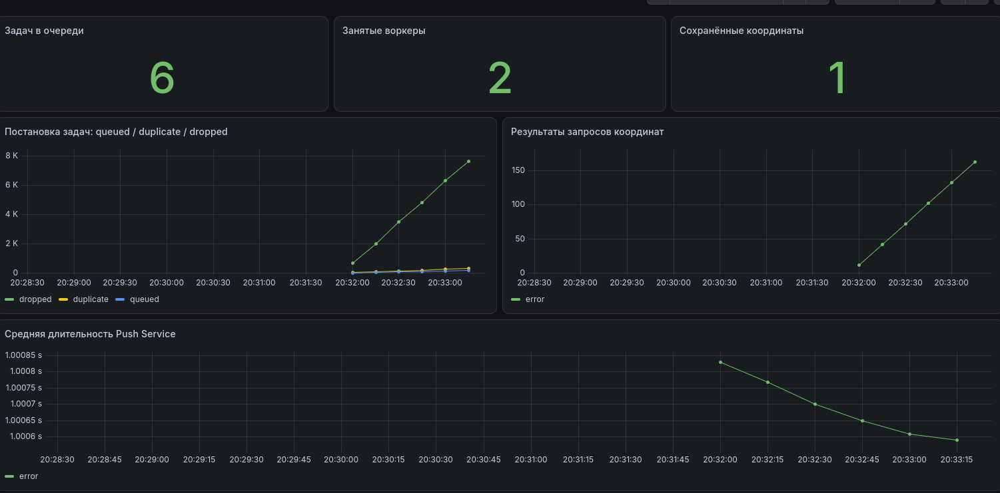
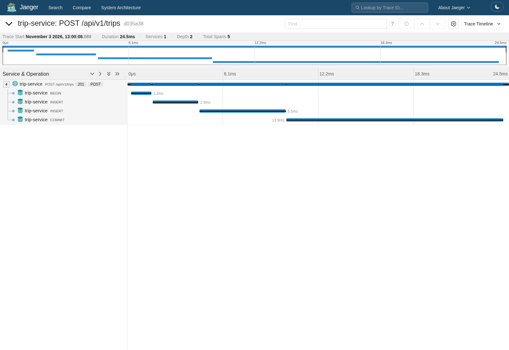
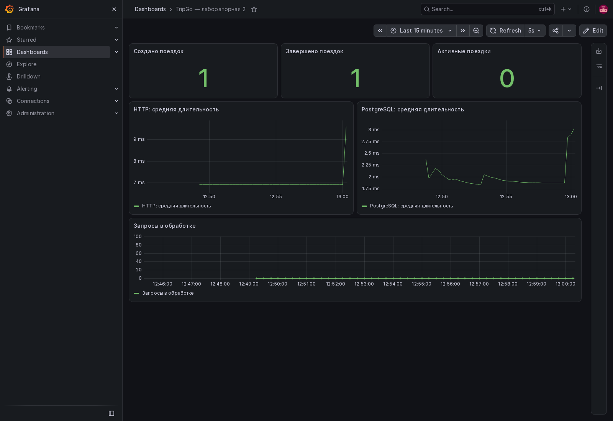

# TripGo — лабораторная работа 3

Сервис поездок принимает координаты, возвращает маршрут и запрашивает
отсутствующие координаты через Push Service. В основе — архитектура,
транзакции и телеметрия предыдущих работ. Контракты и старые миграции
не изменялись. Дополнительные задания с батчами и приоритетной очередью не выполнялись.

## Запуск

Нужны Go версии из `go.mod`, Make и установленный `tripgoctl`.

```bash
tripgoctl cluster start
tripgoctl environment start
tripgoctl connect
make migrate
make run
```

`environment.toml` выбирает лабораторную 3 с PostgreSQL, observability и Push Service.
Адреса БД, коллектора, Jaeger, Prometheus и Grafana берутся из `tripgoctl connect`.
Используйте сгенерированный `.env`; `.env.example` показывает остальные параметры.
Не заменяйте свои адреса и секреты примерами из репозитория.
Порты примера соответствуют проверенному локальному окружению и могут отличаться.

Если `.env` остался от предыдущих работ, обновите `DATABASE_URL`,
`OTEL_EXPORTER_OTLP_ENDPOINT`, `OTEL_EXPORTER_OTLP_PROTOCOL` и `PUSH_HTTP_URL`
по данным `connect`.
Для gRPC endpoint записывается как `http://localhost:<порт gRPC>`.
Переменные процесса имеют приоритет над `.env` при запуске Go-приложения.

По умолчанию HTTP слушает `:8080`. PostgreSQL проверяется перед запуском сервера.
Недоступность настроенного коллектора не мешает обслуживать запросы.
Ctrl+C и SIGTERM запускают graceful shutdown в пределах `SHUTDOWN_TIMEOUT`.

## Команды

| Команда | Действие |
|---|---|
| `make build` | Сборка всех пакетов |
| `make run` | Запуск сервиса |
| `make generate` | Генерация OpenAPI и моков |
| `make test` | Unit-тесты с `-race`, двумя запусками и отчётом покрытия |
| `make test-integration` | Тесты с тегом `integration`, реальной БД, `-race` и двумя запусками |
| `make lint` | Обязательные линтеры и ограничения зависимостей |
| `make migrate` | Применение существующих миграций |
| `make migrate-status` | Состояние миграций |
| `make migrate-down` | Откат одной последней миграции с удалением её таблицы |
| `make docker-run` | Сборка и запуск контейнера на порту 8001 |

Makefile читает `.env` как набор присваиваний Make. Для значений со специальными
символами Make используйте подходящее экранирование или аргументы команды.
`coverage.out`, `.env` и `.tripgo/` не коммитятся.

## Архитектура

```text
cmd/trip-service        конфигурация, запуск, ожидание остановки
internal/container      создание и связывание зависимостей
internal/domain/trip    поездка, валидация, переход статуса, ошибки
internal/model          типы обмена между слоями
internal/usecase/trip    create, get, finish
internal/usecase/position create, list
internal/http/trip       create, get, finish и преобразование моделей
internal/http/position   create, list
internal/http/domainerror преобразование ошибки в Problem
internal/http/middleware  recover, tracing, logging, metrics
internal/repository/trip  параметризованные SQL-запросы
internal/infra/postgres   пул и инструментирование pgx
internal/infra/postgres/transaction менеджер транзакций
internal/infra/telemetry  OTLP, логгер и бизнес-метрики
internal/infra/clock      часы и адаптер тикера для подмены в тестах
internal/worker/positions сканер, очередь и фиксированный пул воркеров
internal/gateway/push    HTTP-клиент Push Service
internal/generated      OpenAPI-код
```

Путь запроса: HTTP → usecase → доменная модель и интерфейсы → репозиторий → БД.
Домен и usecase не импортируют HTTP, pgx, squirrel или сгенерированный API.
API-модели преобразуются только в транспорте. `model` переиспользует доменные
типы через алиасы, чтобы не дублировать одинаковые структуры.
HTTP-обработчик реализует сгенерированный `api.ServerInterface`; соответствие
проверяется компилятором. Маршруты подключаются через `api.HandlerWithOptions`,
запросы и ответы используют DTO из OpenAPI.

Интерфейсы объявлены в `contract.go` у потребителя и не экспортируются.
Usecase получает только необходимые методы репозитория и менеджера транзакций.
Хендлер получает интерфейс своего usecase. Моки генерируются рядом с тестами
через `go:generate`, отдельного пакета mocks нет.

Конкретные зависимости создаёт только `container.New`. В `main` остаются конфиг,
вызов контейнера, запуск HTTP и ожидание ошибки или сигнала. Существующий путь
`cmd/trip-service` сохранён, чтобы команды запуска и Dockerfile не менялись.
Логгер передаётся зависимостью; глобального бизнес-логгера и глобального пула нет.
Правила зависимостей проверяет `depguard` в `.golangci.yml`.

Переход `active → completed` описывает доменный метод `Trip.Finish`.
Репозиторий сохраняет его условным `UPDATE ... WHERE status = 'active'`:
два одновременных завершения дают один успех и один конфликт.
Частичный уникальный индекс запрещает две активные поездки одному водителю.

Создание и завершение записывают историю в том же `TxManager.Do`.
Транзакция хранится в контексте; вложенный `Do` использует её повторно.
Ошибка или паника вызывают откат. Вне `Do` репозиторий использует пул.
Изоляция `Read Committed` достаточна, поскольку конкурентные изменения защищены
индексом и условным UPDATE, а не проверкой состояния только в Go.
Уровень `Serializable` потребовал бы дополнительной обработки ошибок сериализации
и повторов транзакций без необходимости для этих операций.

Индекс `trips_one_active_per_driver_idx` по `driver_id` для `status = 'active'`
проверяет уникальность и при конкурентных INSERT. Нарушение этого ограничения
возвращается клиенту как `409 driver_busy`.

При конкурентном завершении PostgreSQL блокирует изменяемую строку: второй
UPDATE ждёт окончания первой транзакции. После её коммита условие
`status = 'active'` проверяется повторно и уже не выполняется. Репозиторий
проверяет число обновлённых строк и возвращает `409 trip_completed`, если поездка
существует, или `404 trip_not_found`, если её нет. Если первая транзакция откатилась,
второй запрос может успешно завершить поездку. История добавляется только после
успешного UPDATE в той же транзакции, поэтому повторной записи о завершении нет.

## Конфигурация

| Переменная | По умолчанию | Назначение |
|---|---|---|
| `DATABASE_URL` | Обязательна | PostgreSQL |
| `HTTP_ADDR` | `:8080` | HTTP-сервер |
| `LOG_LEVEL` | `info` | Уровень логов |
| `SHUTDOWN_TIMEOUT` | `30s` | Общий бюджет остановки |
| `DATABASE_MAX_CONNS` / `DATABASE_MIN_CONNS` | `25` / `5` | Размер пула |
| `DATABASE_CONNECT_TIMEOUT` | `5s` | Подключение и стартовый Ping |
| `DATABASE_QUERY_TIMEOUT` | `3s` | Операция БД, readiness и cleanup транзакции |
| `DATABASE_MAX_CONN_LIFETIME` | `30m` | Срок жизни соединения |
| `HTTP_READ_TIMEOUT` | `10s` | Чтение запроса |
| `HTTP_READ_HEADER_TIMEOUT` | `5s` | Чтение заголовков |
| `HTTP_WRITE_TIMEOUT` | `15s` | Запись ответа |
| `HTTP_IDLE_TIMEOUT` | `60s` | Keep-alive |
| `OTEL_SERVICE_NAME` | `trip-service` | Имя сервиса |
| `SERVICE_VERSION` | `local` | Версия сборки в ресурсе OTel |
| `OTEL_EXPORTER_OTLP_ENDPOINT` | Обязательна | URL коллектора |
| `OTEL_EXPORTER_OTLP_PROTOCOL` | `grpc` | `grpc` или `http/protobuf` |
| `OTEL_TRACES_SAMPLER` | `parentbased_always_on` | Стратегия сэмплирования |
| `OTEL_TRACES_SAMPLER_ARG` | `1` | Доля для `traceidratio` / `parentbased_traceidratio` |
| `OTEL_METRIC_EXPORT_INTERVAL` | `5000` | Период экспорта в миллисекундах |
| `OTEL_RESOURCE_ATTRIBUTES` | Стандартные env OTel | Дополнительные атрибуты ресурса |
| `POSITION_CHECK_INTERVAL` | `30s` | Период проверки и повторного запроса координаты |
| `POSITION_STALE_AFTER` | `60s` | Сколько времени координата считается свежей |
| `POSITION_WORKERS` | `4` | Число воркеров |
| `POSITION_QUEUE_SIZE` | `100` | Вместимость FIFO-канала |
| `PUSH_HTTP_URL` | Обязателен | Базовый HTTP-адрес Push Service из `connect` |
| `PUSH_REQUEST_TIMEOUT` | `1s` | Таймаут одной попытки отправки |

По умолчанию ресурс содержит `service.namespace=tripgo` и
`deployment.environment=local`. Самплеры `always_on`, `always_off` и их
`parentbased`-варианты также поддерживаются. Длительности должны быть
положительными, размер пула — `0 <= min <= max`, `max > 0`.

## Опрос устаревших поездок

```text
тикер → SQL-выборка → ограниченный FIFO-канал → фиксированные воркеры → Push Service
                         ↑
              отмена после сохранения координаты
```

Один сканер раз в `POSITION_CHECK_INTERVAL` выбирает активные поездки,
у которых `COALESCE(last_position_at, started_at)` старше `POSITION_STALE_AFTER`.
Условие времени и сортировка по давности находятся в SQL. Выборка без `LIMIT`:
батчи относятся к дополнительному заданию. Индекс и результат проверки
на 5000 поездках описаны в [docs/lab03-explain.md](docs/lab03-explain.md).

Очередь вмещает `POSITION_QUEUE_SIZE` задач. Постановка неблокирующая:
при заполнении задача получает `dropped` и лог Warn. Поездка остаётся в БД
и снова попадёт в выборку на следующем тике. Отдельного времени отправки пуша
не храним: паузой между повторными запросами служит период сканера.

Map ожидающих и обрабатываемых задач защищена mutex. Пока задача не завершена,
повторная постановка даёт `duplicate`. После коммита координаты usecase
вызывает отмену через интерфейс очереди. Из канала физически извлечь произвольную
задачу нельзя: воркер пропускает её, если запись в map уже удалена или заменена.
Проверяется именно экземпляр задачи, поэтому старая отменённая задача не затронет
новую задачу той же поездки. Уже начавшийся HTTP-вызов отменой ожидающей задачи
не прерывается.

Воркеров ровно `POSITION_WORKERS`, они не создают горутину на каждую задачу.
Одна попытка ограничена `PUSH_REQUEST_TIMEOUT`; ошибки Push Service не останавливают
воркер. HTTP-клиент собственный, запросы строятся сгенерированным клиентом контракта.
Ретраев и rate limiter в этой работе нет.

Задача хранит SpanContext проверки. Воркер создаёт отдельный корневой спан
со span link на проверку, а исходящий HTTP-вызов становится его дочерним спаном.
Контекст сканера не используется как контекст жизни задачи.

При остановке сначала завершается HTTP, затем сканер перестаёт добавлять задачи
и закрывает канал. Воркеры дорабатывают очередь. После них закрываются
Push-клиент, телеметрия и пул БД. Бюджет `SHUTDOWN_TIMEOUT` общий для HTTP и
фоновых компонентов; по его истечении запросы отменяются, процесс принудительно
завершается. Для сканера и валидации доступны подменяемые тикер и часы.

Дашборд пула: [deploy/grafana/positions.json](deploy/grafana/positions.json).
После импорта в Grafana откройте `/d/tripgo-lab03`.
Он показывает размер очереди, занятых воркеров, сохранённые координаты,
`queued/duplicate/dropped`, результаты пушей и их длительность.

Проверка под нагрузкой: 200 активных поездок, 2 воркера, очередь на 10 задач.
Задержка Push Service — 5 с, таймаут отправки — 1 с. На скриншоте заняты
2 воркера, в очереди 6 задач, растёт `dropped`, а вызовы завершаются
по таймауту примерно через секунду. HTTP-ручки при этом продолжают работать.



## Телеметрия

Данные идут через OTLP в коллектор, затем в Jaeger и Prometheus/Grafana.
Порядок middleware: Recover → Tracing → Logging → Metrics → роутер.
HTTP-спаны называются по методу и шаблону маршрута. В атрибутах и метриках
используется `/api/v1/trips/{tripId}`, а не конкретный UUID.
W3C TraceContext принимается из HTTP-заголовков.

SQL инструментируется на уровне пула через `otelpgx`. Обёртка tracer добавляет
имя таблицы и DB-гистограмму с нужными атрибутами. Репозиторий не знает про OTel.
Бизнес-счётчики увеличиваются только после успешного Commit, активные поездки
измеряются по БД при сборе gauge.

Метрики: `http.server.request.duration`, `http.server.active_requests`,
`db.client.operation.duration`, `tripgo.trips.created`, `tripgo.trips.completed`,
`tripgo.trips.active`. Prometheus преобразует точки в подчёркивания и добавляет
суффиксы единиц измерения, histogram и counter.

Логи — JSON с `service`, `trace_id` и `span_id`. На запрос пишется одна access-запись:
2xx/4xx — Info, 5xx — Error. Бизнес-события пишутся отдельно после успешной операции.
Тела и секреты не логируются. Recover возвращает безопасный `500 internal_error`
и записывает панику со стеком.

Готовый дашборд: `deploy/grafana/tripgo.json`. Его можно импортировать в Grafana
через Dashboards → New → Import. Используется datasource `prometheus` окружения курса.
Адреса интерфейсов и учебные реквизиты печатает `tripgoctl connect`.





## API

POST `/api/v1/trips` создаёт поездку и возвращает 201 и Location.
GET `/api/v1/trips/{tripId}` возвращает поездку, POST на `/finish` завершает её.
Ошибки 400/404/409/500 имеют формат `application/problem+json`.
`/health` отвечает без БД, `/ready` проверяет Ping и отдаёт 200 или 503.

POST `/api/v1/trips/{tripId}/positions` сохраняет точку и возвращает `201`.
GET по тому же пути возвращает `200` и все точки в порядке `recorded_at`, `id`.
У существующей поездки без координат ответ — `{"positions":[]}`.
Сохранение в завершённую поездку даёт `409`, отсутствующая поездка — `404`.
Координаты вне диапазона, пропущенные поля и время более чем на минуту
в будущем дают `400`. Старые координаты принимаются.

INSERT точки и обновление `last_position_at` находятся в одной транзакции.
Сначала условный UPDATE блокирует активную поездку, поэтому завершение
не может вклиниться между проверкой статуса и записью точки.
`GREATEST(last_position_at, recorded_at)` сравнивает времена в SQL:
опоздавшая точка сохраняется в маршрут, но не уменьшает `last_position_at`.

```bash
curl -i localhost:8080/ready
curl -i -X POST localhost:8080/api/v1/trips \
  -H 'Content-Type: application/json' \
  -d '{"user_id":"5cb72c04-7650-45c9-a79b-bcdba0631e0c","driver_id":"8860b315-ec86-42eb-a17c-7c163d721ff5","start_point":{"latitude":59.9398,"longitude":30.3146},"end_point":{"latitude":59.929,"longitude":30.3626},"price":1450}'
```

Подставьте ID созданной поездки в `TRIP_ID`:

```bash
TRIP_ID='<id>'
curl -i -X POST "localhost:8080/api/v1/trips/$TRIP_ID/positions" \
  -H 'Content-Type: application/json' \
  -d "{\"coordinates\":{\"latitude\":59.93,\"longitude\":30.33},\"recorded_at\":\"$(date -u +%FT%TZ)\"}"
curl -i "localhost:8080/api/v1/trips/$TRIP_ID/positions"
```

Для проверки опроса создайте поездку и не отправляйте координаты.
После `POSITION_STALE_AFTER` команда появится в логах:

```bash
tripgoctl environment logs push-service
```

## Docker

Сохранена многостадийная сборка и запуск не от root. Для Docker Desktop укажите
в `.env` `DOCKER_DATABASE_URL`, `DOCKER_OTEL_EXPORTER_OTLP_ENDPOINT` и
`DOCKER_PUSH_HTTP_URL` с хостом
`host.docker.internal` и портами БД/коллектора из `connect`, затем `make docker-run`.
Локальный Go-процесс использует `DATABASE_URL` и `OTEL_EXPORTER_OTLP_ENDPOINT`
с адресами, доступными компьютеру. Секреты не копируются в образ.
Проверка контейнера: `curl -i localhost:8001/ready`.
