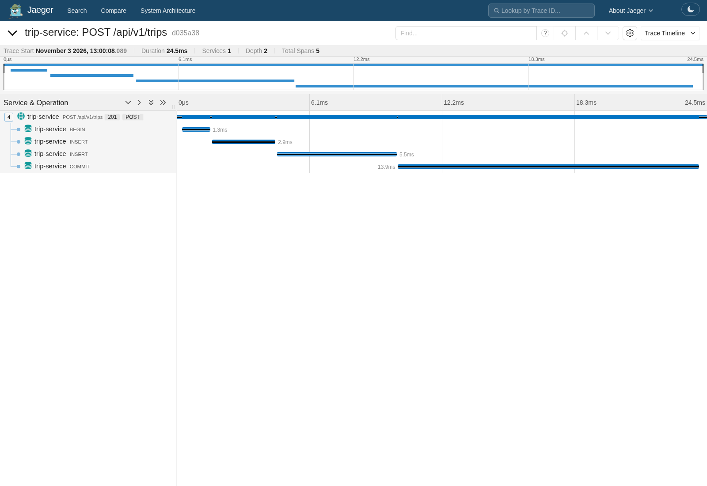
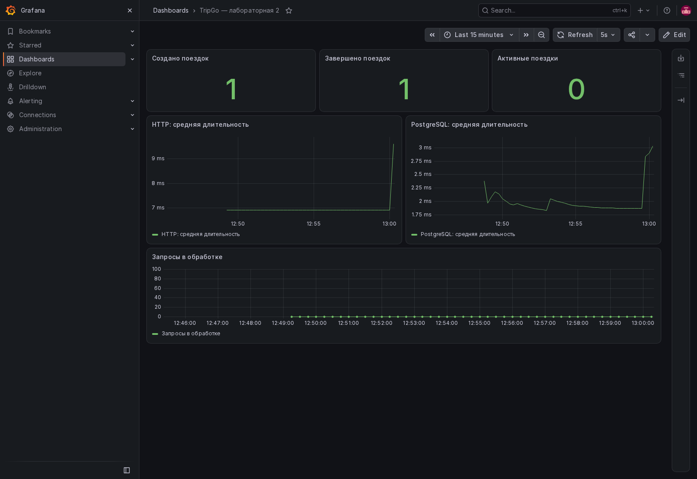

# Проверка второй лабораторной

Проверено 3 ноября 2026 в локальном окружении `tripgo-lab-02`.

| Проверка | Результат |
|---|---|
| Сборка всех пакетов | Успех |
| Линтеры курса и depguard | 0 issues |
| Unit-тесты с `-race`, `-count=2` | Успех |
| Покрытие домена | 95% |
| Покрытие каждого usecase | 100% |
| Интеграционные тесты с `integration`, `-race`, `-count=2` | Успех |
| Миграции Up → Down → Up в тестовой схеме | Успех |
| Откаты, паника, вложенный Do | Успех |
| 20 созданий одному водителю | Одна созданная поездка |
| Два завершения одной поездки | Один успех и один конфликт |
| Демонстрационные HTTP-запросы | Создание 201, получение 200, завершение 200, повтор 409, readiness 200 |
| OTLP → Jaeger | HTTP-спан с вложенными DB-спанами |
| OTLP → Prometheus | Все шесть требуемых метрик присутствуют |
| Работа с недоступным коллектором | Отдельный процесс с OTLP endpoint `127.0.0.1:1` запустился, readiness 200 |

Тесты PostgreSQL создают отдельную схему и удаляют её после себя.
Недоступность коллектора проверялась отдельным экземпляром с недоступным адресом;
общий коллектор окружения не останавливался.

Пример корреляции: `trace_id=d035a380281c52cb17f0d802d239df96` присутствовал
и в JSON-логе создания поездки, и в Jaeger.

На скриншоте Jaeger показаны HTTP-запрос и SQL внутри транзакции:

На скриншоте Grafana показаны бизнес-счётчики, активные поездки и длительности:

Скриншоты относятся к демонстрационному запуску. После перезапуска окружения
трейсы могут исчезнуть из временного хранилища; выполните новые запросы и найдите
их по текущему `trace_id`. Дашборд сохранён в `deploy/grafana/tripgo.json`.
